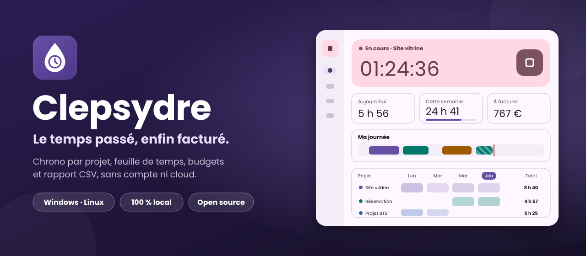
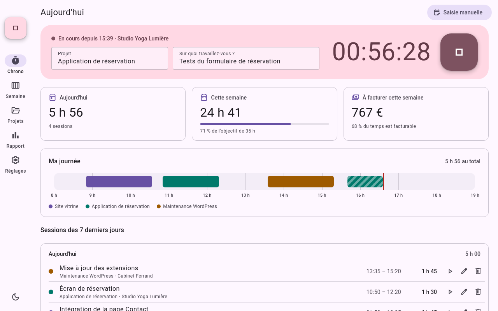
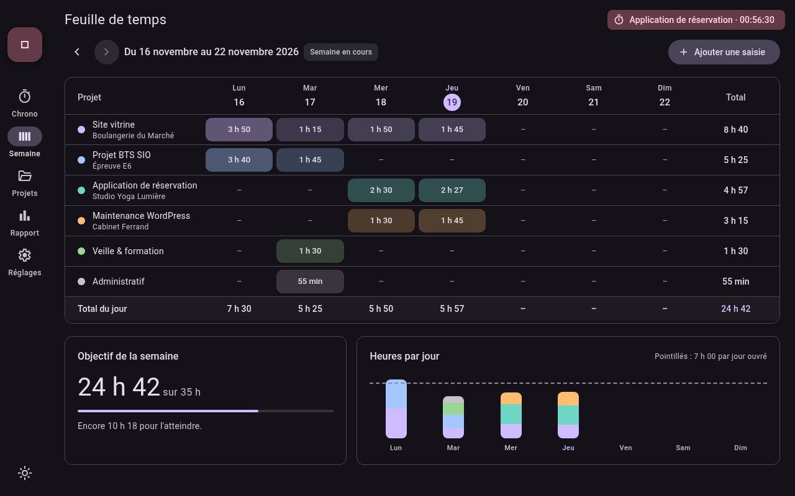
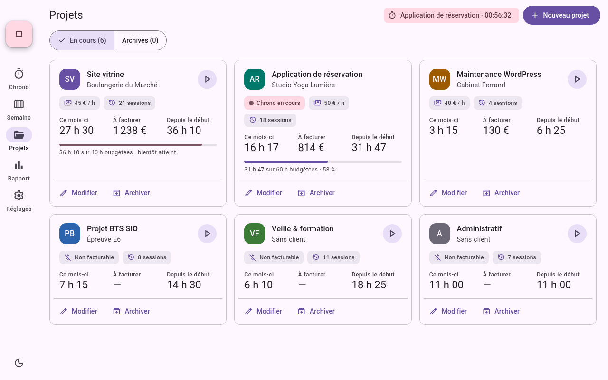
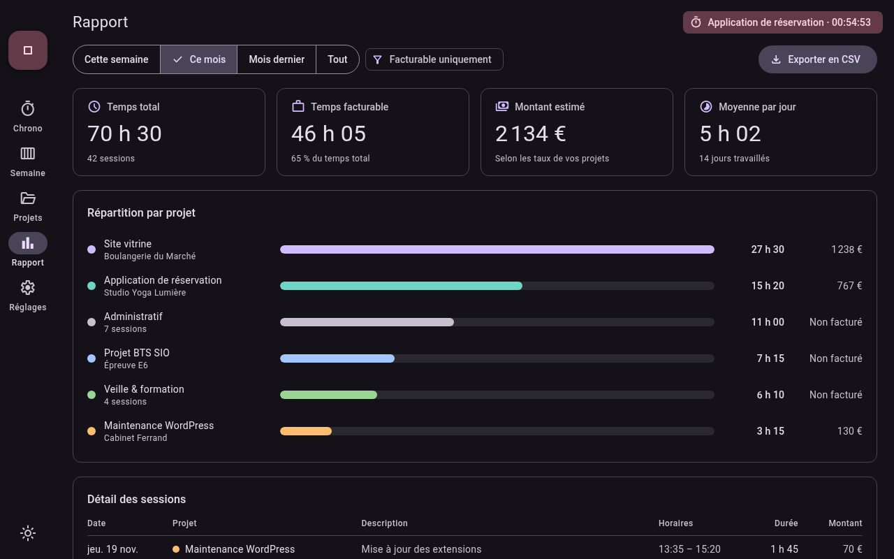

<p align="center">
  
</p>

<p align="center">
  <a href="https://github.com/JulesROGUE/clepsydre/releases/latest"></a>
  
  
  <a href="LICENSE"></a>
</p>

<p align="center">
  <b>Chronométrez votre travail par projet, remplissez votre feuille de temps et sachez enfin combien facturer.</b><br>
  Une app de bureau 100 % locale : pas de compte, pas de cloud, pas d'abonnement.
</p>

<p align="center">
  <a href="https://github.com/JulesROGUE/clepsydre/releases/latest"><b>⬇️ Télécharger pour Windows ou Linux</b></a>
</p>

---

## Pourquoi

Quand on est freelance, alternant ou étudiant en projet, on enchaîne les clients, les missions et les cours. À la fin du mois, il faut reconstituer ses heures de mémoire : une partie du temps passé n'est jamais facturée, et on ne sait plus si le budget d'un projet est dépassé.

Les outils de suivi du temps existent, mais ils demandent presque tous un compte en ligne et un abonnement, et stockent vos journées de travail sur leurs serveurs.

**Clepsydre** fait l'essentiel, hors ligne : un chrono par projet, une feuille de temps de la semaine, le suivi des budgets et un rapport exportable en CSV pour préparer vos factures. Vos données restent sur votre ordinateur.

## Aperçu

<p align="center">
  
  
</p>
<p align="center">
  
  
</p>

## Fonctionnalités

| | Fonctionnalité | Détail |
|---|---|---|
| ⏱️ | **Chrono par projet** | Un clic pour démarrer ou arrêter, une description facultative, la session en cours survit à la fermeture de l'app. |
| 📅 | **Frise de la journée** | Chaque session apparaît en couleur sur la journée, avec l'heure actuelle et le total. |
| 🗓️ | **Feuille de temps** | Tableau projets × jours, totaux par jour et par projet, navigation de semaine en semaine. Un clic sur une case ajoute une saisie. |
| 🎯 | **Objectif hebdomadaire** | Progression vers vos heures visées et graphique des heures par jour. |
| 💼 | **Projets et budgets** | Client, couleur, taux horaire, temps facturable ou non, budget en heures avec alerte à 85 % et au dépassement. |
| 📊 | **Rapport** | Semaine, mois, mois dernier ou tout : temps total, part facturable, montant estimé, moyenne par jour, répartition par projet. |
| 📤 | **Export CSV** | Prêt pour Excel ou LibreOffice (séparateur « ; », décimales à virgule), avec arrondi optionnel par session (5, 15 ou 30 min). |
| ✏️ | **Saisie manuelle** | Ajoutez, corrigez ou supprimez une session oubliée, avec annulation de la suppression. |
| 💾 | **Sauvegarde** | Export et import de toutes vos données au format JSON. |
| 🌗 | **Thème clair / sombre** | Material You, suit le système ou se choisit dans les réglages. |
| 🔒 | **100 % local** | Aucune connexion, aucun compte, aucune télémétrie. |

## Installation

Téléchargez le fichier qui vous convient sur la [page de la dernière version](https://github.com/JulesROGUE/clepsydre/releases/latest) :

| Système | Fichier | Utilisation |
|---|---|---|
| Windows | `Clepsydre-Setup-1.0.0.exe` | Installateur classique (raccourcis, désinstallation). |
| Windows | `Clepsydre-1.0.0-portable.exe` | Version portable : un seul fichier, sans installation. |
| Linux | `Clepsydre-1.0.0-linux-x86_64.AppImage` | Toutes distributions : `chmod +x Clepsydre-*.AppImage` puis lancez-le. |
| Linux | `Clepsydre-1.0.0-linux-amd64.deb` | Debian, Ubuntu et dérivées : `sudo apt install ./Clepsydre-*.deb` |

> **Windows SmartScreen** : l'exécutable n'est pas signé (un certificat de signature est payant). Au premier lancement, Windows peut afficher « Windows a protégé votre ordinateur » : cliquez sur **Informations complémentaires** puis **Exécuter quand même**. Le code source est ici, et les fichiers sont compilés par GitHub Actions à partir de ce dépôt.

Vos données sont enregistrées dans le dossier de profil de l'application sur votre ordinateur. Pensez à la sauvegarde JSON (Réglages → Sauvegarder) avant de changer de machine.

## Développement

Prérequis : [Node.js](https://nodejs.org/) 22 ou plus récent.

```bash
git clone https://github.com/JulesROGUE/clepsydre.git
cd clepsydre
npm install
npm start         # compile l'interface et lance l'app Electron
npm run dist      # construit les paquets pour votre système dans release/
```

`npm run dev` lance l'interface seule dans le navigateur (Vite), pratique pour travailler sur le style.

| Couche | Technologie |
|---|---|
| Interface | React 19 (JSX), composants Material You maison (`src/m3/`) |
| Build | Vite |
| Bureau | Electron (fenêtre sécurisée : pas de Node dans l'interface, `contextIsolation`, sandbox) |
| Paquets | electron-builder : NSIS + portable (Windows), AppImage + .deb (Linux) |
| Données | `localStorage` dans le profil de l'app, export / import JSON et CSV |
| Polices | Roboto et Material Symbols, embarquées (fonctionne hors ligne) |
| CI | GitHub Actions : une version est publiée à chaque tag `v*` |

Organisation du code :

```
src/
├── App.jsx              navigation, chrono, sessions, projets
├── views/               Chrono, Semaine, Projets, Rapport, Réglages
├── components/          frise du jour, boîtes de dialogue, petits composants
├── lib/                 dates et durées, calculs, stockage, fichiers, thème
└── m3/                  composants Material You
```

## Licence

[MIT](LICENSE) © Jules ROGUE

- Icônes [Material Symbols](https://github.com/google/material-design-icons) : licence Apache 2.0.
- Police [Roboto](https://github.com/googlefonts/roboto-3-classic) : licence SIL Open Font License 1.1.
